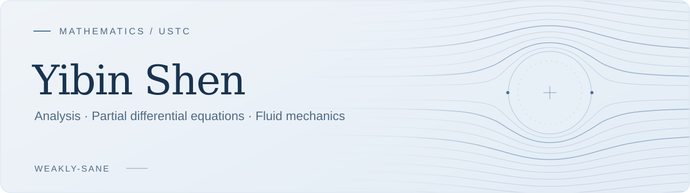

<picture>
  <source media="(prefers-color-scheme: dark)" srcset="assets/header-dark.svg">
  <source media="(prefers-color-scheme: light)" srcset="assets/header-light.svg">
  
</picture>

  <a href="https://github.com/weakly-sane/math-notes"><b>Math notes</b></a>
  &nbsp; · &nbsp;
  <a href="https://github.com/weakly-sane/math-notes/tree/main/research/navier-stokes">Research reading</a>
  &nbsp; · &nbsp;
  <a href="mailto:cy915082191@mail.ustc.edu.cn">Contact</a>

I am an undergraduate mathematics student at the **University of Science and Technology of China (USTC)**. My interests lie in **analysis and partial differential equations**, with a focus on **fluid PDEs**.

<table>
  <tr>
    <td width="50%" valign="top">
      <h3>Regularity &amp; rigidity</h3>
      
The Navier–Stokes equations, Liouville-type theorems, and the qualitative behavior of solutions.

      
I am also learning about regularity theory and free-boundary problems.

    </td>
    <td width="50%" valign="top">
      <h3>A mathematical notebook</h3>
      
Course notes, worked problems, and paper-reading notes, collected as I learn.

      

        <a href="https://github.com/weakly-sane/math-notes/tree/main/notes/measure-theory">Measure theory</a> ·
        <a href="https://github.com/weakly-sane/math-notes/tree/main/notes/probability">Probability</a> 
        <a href="https://github.com/weakly-sane/math-notes/tree/main/notes/graph-theory">Graph theory</a> ·
        <a href="https://github.com/weakly-sane/math-notes/tree/main/notes/pde">PDE</a>
      

    </td>
  </tr>
</table>

### A guiding equation

$$
-\Delta u + (u\cdot\nabla)u + \nabla p = 0,
\qquad \nabla\cdot u = 0.
$$

How do **decay**, **integrability**, and **scale-critical assumptions** constrain the behavior of solutions?

---

Trying to prove strong results while remaining <code>weakly-sane</code>.

